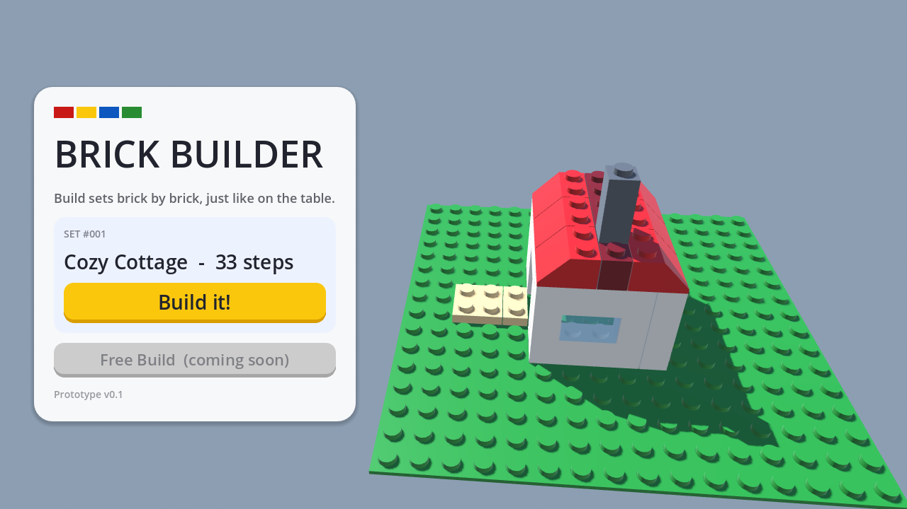
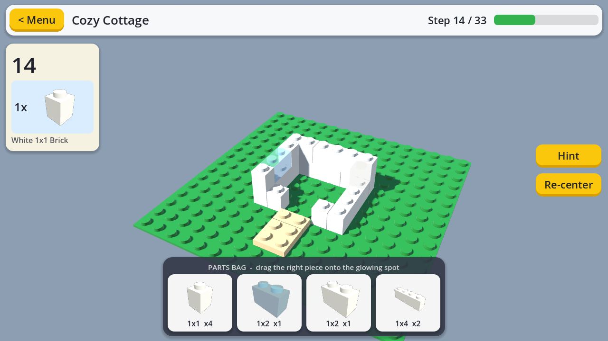
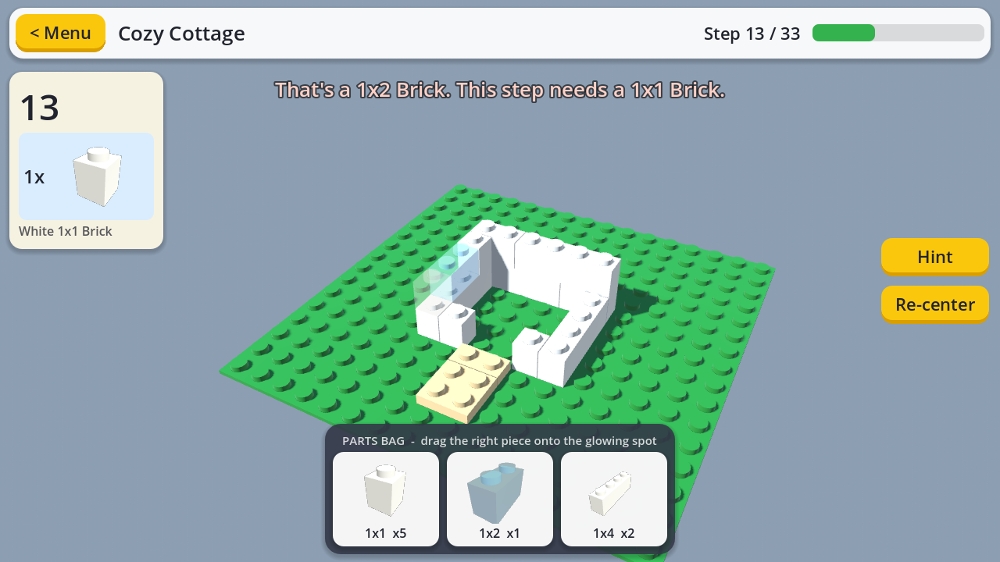
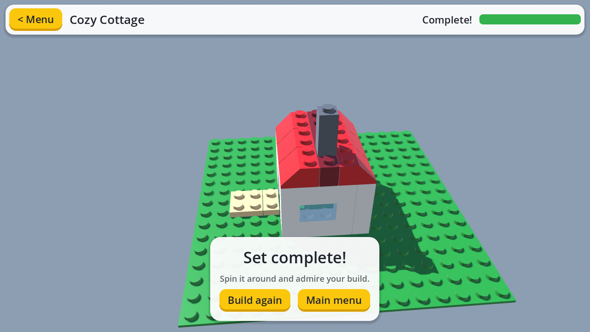

# Brick Builder (prototype)

A mobile game about building brick sets the way you do at the table. You open the bag,
follow the numbered steps, find the right piece, and snap it onto the studs.

Built with **Godot 4.3** using the Compatibility renderer, so it runs on almost any Android phone.
All bricks are generated in code, so the project has no external 3D assets.

| Main menu | Building |
|---|---|
|  |  |
| **Wrong piece feedback** | **Set complete** |
|  |  |

## Game design
The full game plan (modes, box opening, sandbox, progression, money, roadmap) is in [docs/GAME_DESIGN.md](docs/GAME_DESIGN.md).

## How to play
- The **instruction box** (top left) shows the step number and the piece you need.
- A **glowing ghost brick** shows where that piece goes.
- **Drag the matching piece** out of the **Parts Bag** onto the glowing spot. The right
  piece snaps in when you drop it within one stud. A wrong piece bounces back with a tip.
- Camera: drag with one finger to rotate, pinch to zoom, drag with two fingers to pan.
  On desktop, use the left mouse button to rotate, the right button to pan and the wheel to zoom.
- **Hint** makes the ghost brick and the right piece in the bag flash.

## Try it on your Android phone
Every push runs the **Android APK** GitHub Actions workflow.
1. On GitHub, open **Actions → Android APK →** the latest run.
2. Download the **BrickBuilder-debug-apk** artifact (a zip), then unzip it on your phone.
3. Open `BrickBuilder.apk` and allow "install unknown apps" when Android asks.

## Run on a computer
1. Install [Godot 4.3](https://godotengine.org/download) (standard edition).
2. Open Godot, choose **Import**, and select `project.godot` in this folder.
3. Press **F5** to run.

## Project layout
```
scripts/brick/BrickDefs.gd         part catalog, colors, materials
scripts/brick/BrickMeshFactory.gd  procedural brick and baseplate meshes (body + studs)
scripts/brick/Brick.gd             a placed brick (mesh + collider)
scripts/build/StudGrid.gd          stud grid / height map (bricks rest on the highest stud)
scripts/build/GuidedBuild.gd       step logic, ghost brick, drag and drop validation
scripts/build/DragPlacer.gd        finger position -> stud-grid position
scripts/build/OrbitCamera.gd       touch and mouse camera
scripts/ui/*.gd                    HUD, main menu, 3D part previews, theme
scripts/Main.gd                    game root and mode switching
sets/house_01.json                 the "Cozy Cottage" set (33 steps)
```

### Adding a new set
A set is a JSON file with a list of steps:
```json
{"part": "brick_1x4", "color": "white", "cell": [5, 0, 6], "rot": 0}
```
`cell` is `[x, y, z]`: x and z are in studs, and y is in plates (1 brick = 3 plates).
`rot` is in 90° turns. When the set loads, the game checks that every step rests on what
was built before it, and reports any step that would be floating or overlapping.

### Automated screenshots
```
godot -- --shot=out.png --scene=build --steps=10 --drag
```
`--scene` can be `menu`, `build` or `done`.

---
"Brick Builder" is a working title. This project is not affiliated with or endorsed by any toy brick manufacturer.
