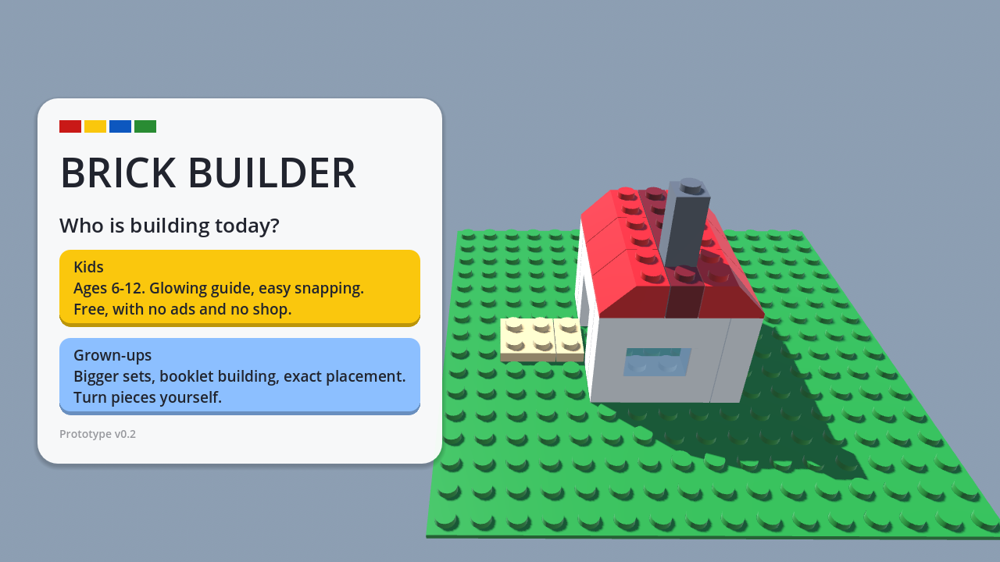
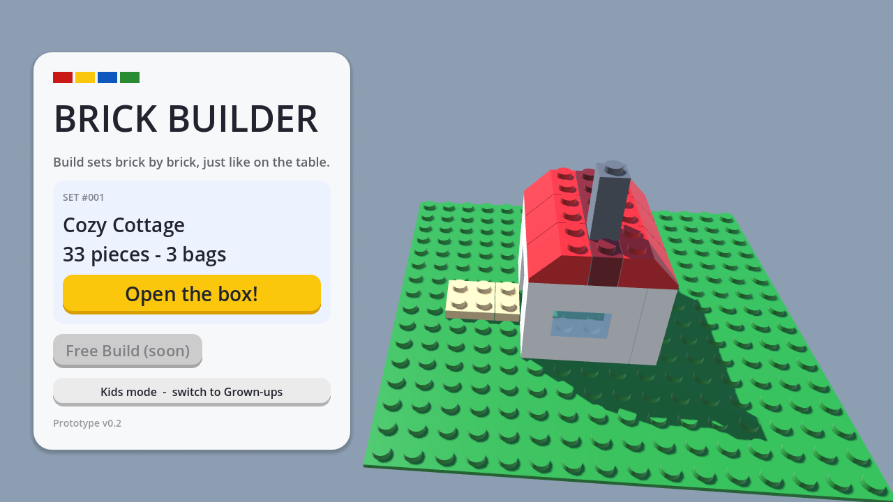
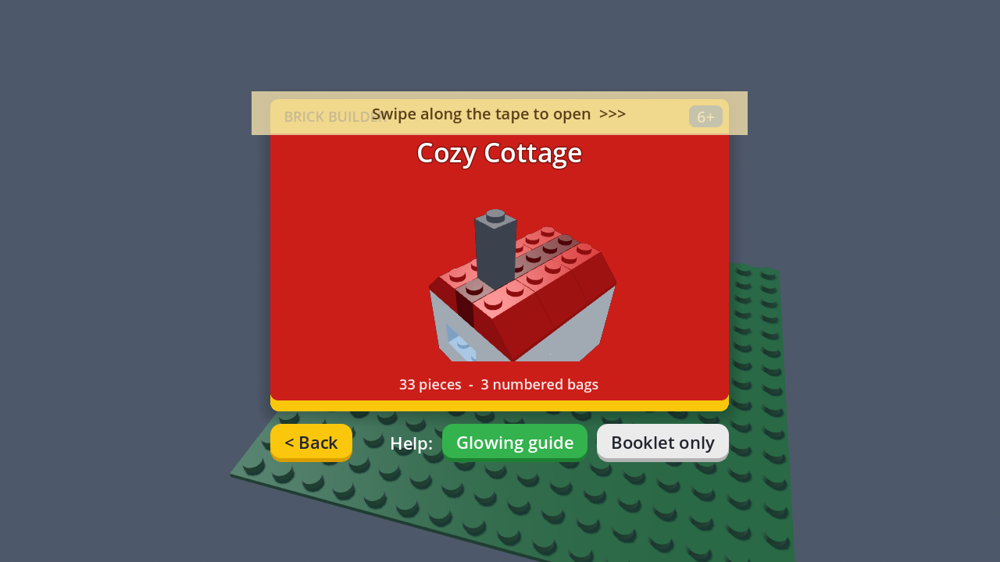
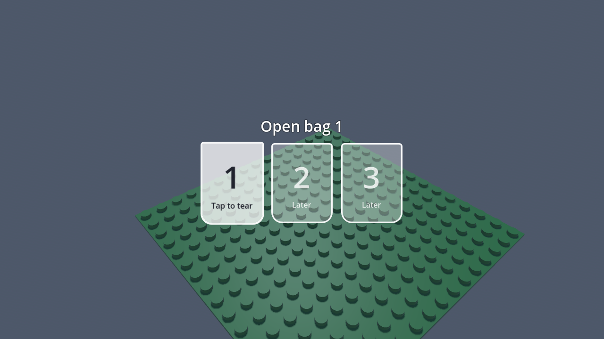
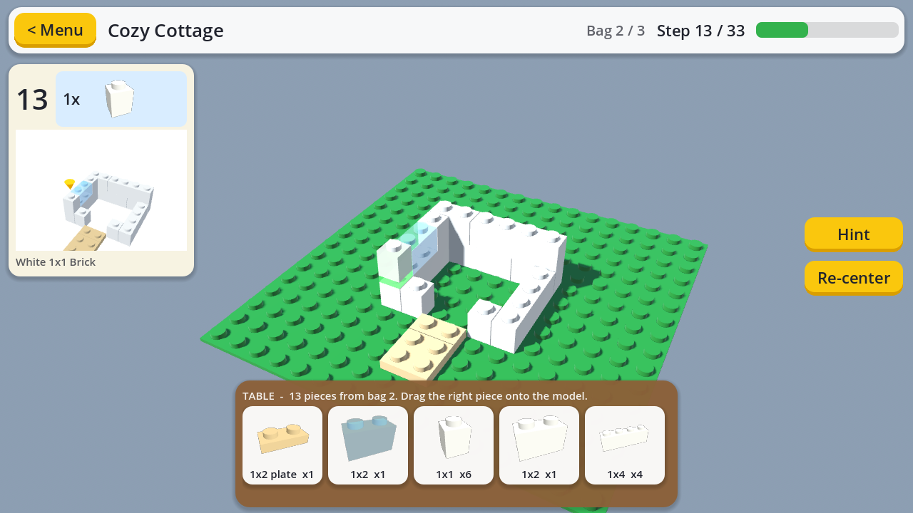
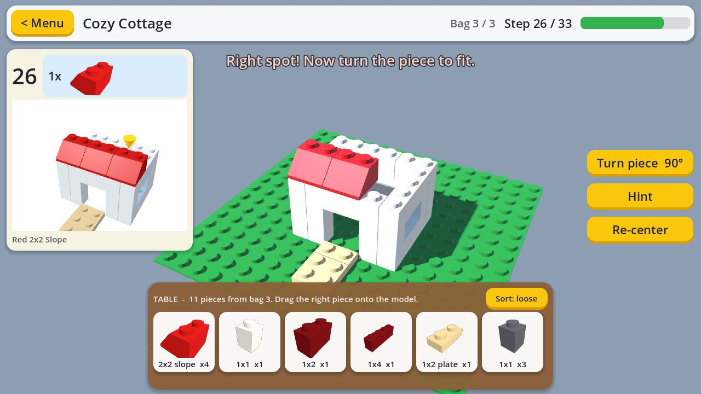
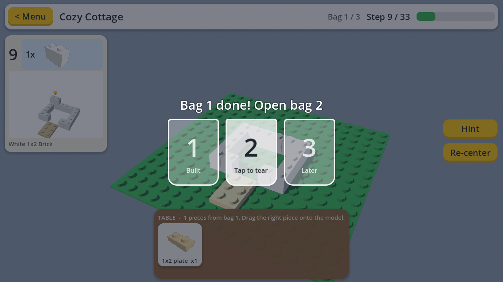
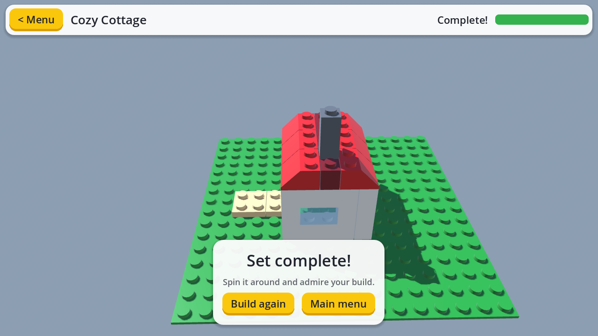

# Brick Builder (prototype)

A mobile game about building brick sets the way you do at the table. You open the bag,
follow the numbered steps, find the right piece, and snap it onto the studs.

Built with **Godot 4.3** using the Compatibility renderer, so it runs on almost any Android phone.
All bricks are generated in code, so the project has no external 3D assets.

| Who is building? | Main menu |
|---|---|
|  |  |
| **Swipe to cut the box tape** | **Tear open the numbered bags** |
|  |  |
| **Kids: glowing guide** | **Grown-ups: booklet only, turn pieces yourself** |
|  |  |
| **Bag finished** | **Set complete** |
|  |  |

## Game design
The full game plan (modes, box opening, sandbox, progression, money, roadmap) is in [docs/GAME_DESIGN.md](docs/GAME_DESIGN.md).

## How to play
- **First launch:** choose **Kids** or **Grown-ups**. Kids mode is completely free, with no ads
  and no shop. Switching from Kids to Grown-ups needs a grown-up (a quick sum to answer).
- **Open the box:** swipe along the tape to cut it, then tap bag 1 to tear it open. Its pieces
  spill onto the **table** at the bottom, with real counts and one spare, like a real kit.
- **Pick a help level** on the box screen:
  - **Glowing guide** shows a ghost brick where the next piece goes.
  - **Booklet only** shows just the instruction-page picture, with an arrow on the new piece.
    **Hint** briefly shows the ghost brick.
- **Build:** drag the right piece from the table onto the model. When a bag is finished,
  open the next one.
- **Kids** mode: the right piece snaps in within one stud and turns itself to fit.
- **Grown-ups** mode: placement is exact and you turn pieces yourself. Use **Turn piece**, tap with
  a second finger while dragging, or press **R** on a keyboard. **Sort** cycles the table
  between loose, by color and by type.
- Camera: drag with one finger to rotate, pinch to zoom, drag with two fingers to pan.
  On desktop, use the left mouse button to rotate, the right button to pan and the wheel to zoom.
- Sounds (snap click, bag rip, tape, fanfare) are generated in code; the phone vibrates on each snap.

## Try it on your Android phone
Every push runs the **Android APK** GitHub Actions workflow.
1. On GitHub, open **Actions → Android APK →** the latest run.
2. Download the **BrickBuilder-debug-apk** artifact (a zip), then unzip it on your phone.
3. Open `BrickBuilder.apk` and allow "install unknown apps" when Android asks.

## Run on a computer
1. Install [Godot 4.3](https://godotengine.org/download) (standard edition).
2. Open Godot, choose **Import**, and select `project.godot` in this folder.
3. Press **F5** to run.

## Project layout
```
scripts/brick/BrickDefs.gd         part catalog, colors, materials
scripts/brick/BrickMeshFactory.gd  procedural brick and baseplate meshes (body + studs)
scripts/brick/Brick.gd             a placed brick (mesh + collider)
scripts/build/StudGrid.gd          stud grid / height map (bricks rest on the highest stud)
scripts/build/GuidedBuild.gd       step logic, ghost brick, drag and drop validation
scripts/build/DragPlacer.gd        finger position -> stud-grid position
scripts/build/OrbitCamera.gd       touch and mouse camera
scripts/ui/*.gd                    HUD, main menu, 3D part previews, theme
scripts/Main.gd                    game root and mode switching
scripts/Profile.gd                 saved settings: Kids/Grown-ups mode, help level
scripts/Sfx.gd                     sound effects synthesised in code + vibration
scripts/ui/BoxScreen.gd            box with tape to cut, numbered bags to tear open
scripts/ui/ModelPreview.gd         box art and instruction-booklet pictures
scripts/ui/ParentalGate.gd         grown-ups check before leaving Kids mode
sets/house_01.json                 the "Cozy Cottage" set (33 steps in 3 bags)
```

### Adding a new set
A set is a JSON file with `bags` (how many steps each numbered bag holds) and a list of steps:
```json
{"part": "brick_1x4", "color": "white", "cell": [5, 0, 6], "rot": 0}
```
`cell` is `[x, y, z]`: x and z are in studs, and y is in plates (1 brick = 3 plates).
`rot` is in 90° turns. When the set loads, the game checks that every step rests on what
was built before it, and reports any step that would be floating or overlapping.

### Automated screenshots
```
godot -- --shot=out.png --scene=build --steps=10 --drag
```
`--scene` can be `picker`, `menu`, `box`, `bags`, `build` or `done`. Add `--mode=adult` and
`--guidance=booklet` to test Grown-ups and Booklet mode.

---
"Brick Builder" is a working title. This project is not affiliated with or endorsed by any toy brick manufacturer.
