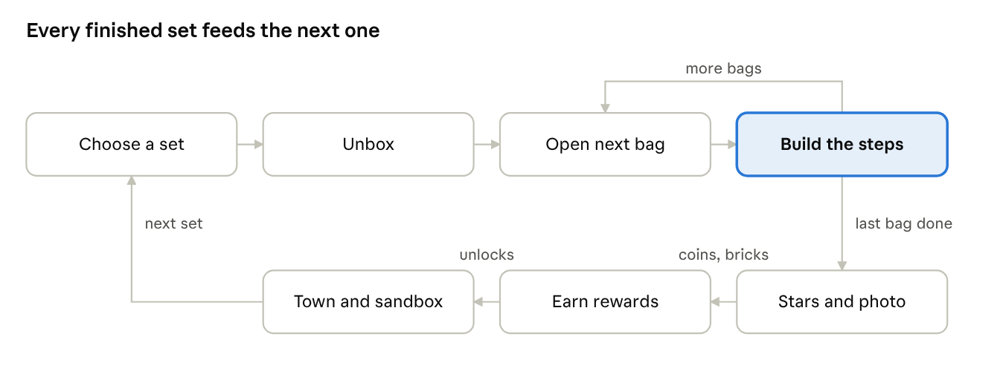
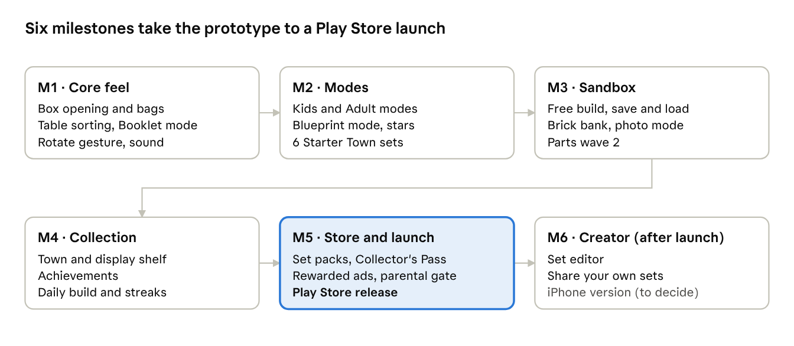

# Brick Builder: Game Design Document

Version of 19 Nov 2026. A shareable, commentable copy lives in a Claude doc; this file is the copy kept with the code.

## Vision and pitch

Brick Builder is the feeling of opening a new brick set on the table, on your phone: cut the box, tear open bag 1, find the right piece, hear the click. It is free to start, has separate Kids and Adult modes, and grows from step-by-step builds into a free-build sandbox and a collection you keep.

- **Pitch:** "Every set, every bag, every click, without the pieces under the sofa."
- **What makes it different:** existing apps are either CAD-style editors or digital instruction viewers. None recreate the ritual of building a physical set: box, numbered bags, sorting pieces on the table, then following the booklet.
- **Design pillars:**
  1. **Tactile:** every placement snaps, clicks and wobbles like real plastic.
  2. **Your pace, your help:** the player picks how much guidance they get, from the glowing ghost brick to no help at all.
  3. **Builds you keep:** every finished set stays in your collection and adds bricks to your sandbox.
- **Brand rule:** the name, sets and art are original; no trademarked brick brand, logos or official set designs.

## Audience and modes

One app has two modes, chosen on first launch and switchable behind a parental gate: **Kids** (ages 6 to 12) and **Adult** (13 and up, collectors). Same bricks and engine; the rules, set sizes, UI and store differ.

| | Kids mode | Adult mode |
| --- | --- | --- |
| Set size | 20 to 80 pieces, 1 to 3 bags | 150 to 1,000+ pieces, 4 to 12 bags |
| Default guidance | Guided (ghost brick always on) | Booklet (no ghost) |
| Placement | Snaps within 1 stud, turns itself to fit | Exact stud and rotation; twist gesture or rotate button |
| Parts on the table | Auto-sorted by color | Spilled loose; player sorts or uses the sort tool |
| Failure | None: wrong piece bounces back with a friendly tip | Mistakes allowed; the "check step" button flags them |
| Scoring | 1 to 3 stars, generous | Stars for no hints, no mistakes, time target |
| Instructions | Pictures only, no reading needed | Pictures plus step counts and part numbers |
| UI | Big buttons, 64 px or larger touch targets | Compact, more of the model on screen |
| Money | Completely free: limited sets and bricks, no ads, no purchases | Rewarded ads (optional) and set packs |

A family can keep one profile per person on the same phone (up to 4), each with its own mode, collection and progress.

## Core loop

One session is 5 to 15 minutes: usually one bag, or one Kids set.

The bag loop is the heartbeat. Finishing a set pays out stars, coins and bricks, which unlock the next set and fill the town and sandbox.

## Build experience

A build follows the physical ritual: unbox, open bag 1, sort the pieces, follow the steps, then move on to the next bag. The player chooses how much help they get, so building is not always guided.

### Unboxing

1. **Box screen:** the 3D box shows the set art, the piece count and the age badge. Tap to pick it up and turn it.
2. **Cut the tape:** swipe along the seam. The lid lifts with a sound and the bags and booklet slide out.
3. **Bags:** numbered bags (1, 2, 3...) lie on the table. Only the next bag can be opened; later ones show a lock until the current bag is built.
4. **Tear the bag:** pinch-pull to rip it. The pieces spill onto the table with light physics, so they tumble and settle.

### The table (parts area)

- Pieces from the open bag lie loose in a tray at the bottom of the screen. It scrolls sideways in Adult mode when it holds many pieces.
- **Sort tools:** by color, by type, or auto-sort (Kids mode sorts automatically). Sorting is optional; it just makes finding pieces faster.
- **Real counts:** a bag contains exactly the pieces its steps use, plus 1 or 2 small spares, like real kits. Spares go to the brick bank when the set is finished.
- Pieces stay on the table if the player leaves mid-build. Progress saves after every placed piece.

### Guidance levels (picked per build)

| Level | What the player sees | How placement is checked | Unlocks |
| --- | --- | --- | --- |
| Guided | Booklet step + glowing ghost brick on the model | Must match the current step | Always (default in Kids mode) |
| Booklet | Only the booklet picture of the step; no ghost | Must match the current step; "check" reveals a mistake | Always (default in Adult mode) |
| Blueprint | The finished model to turn around; no steps | Any order the bricks physically allow; correct when the model matches | After finishing the set once |
| Free build | Nothing; the set's pieces in a sandbox | No checking | After finishing the set once |

In Booklet mode a wrong placement is not rejected; it stays, like in real life. The step only completes when the piece is right, and the **Check** button highlights the wrong piece (costs a star in Adult mode).

### Controls

- **Drag** a piece from the table onto the model; it snaps to the nearest valid studs. The piece shows above the finger so the finger does not hide it.
- **Rotate** a piece in hand: two-finger twist, or the rotate button (Adult mode). Kids mode turns the piece to fit automatically near its spot.
- **Remove** a piece: long-press it on the model, then drag it back to the table.
- **Camera:** one finger orbits, pinch zooms, two fingers pan, double-tap re-centers.
- **Feel:** a click sound and a small squash on every snap, plus light phone vibration; a soft thud and bounce-back for a wrong piece.

## Free-build sandbox

The sandbox lets players build anything. Kids mode has a fixed free palette (about 30 brick types in every color, as many as they like); Adult mode builds only with bricks the player owns, so finishing sets feeds creativity.

- **Brick bank:** every finished set adds its pieces (and spares) to the bank. Adult players can also take apart a finished set from the shelf to free its bricks.
- **Baseplates:** 16x16, 32x32 and 48x48 studs, in several colors.
- **Picking bricks:** a drawer by category (bricks, plates, slopes, tiles, round, special), with color swatches and a search box. Recently used pieces stay at the front.
- **Tools:** undo/redo (50 steps), copy a brick or a selection, recolor, rotate, mirror, a layer slicer to see inside, and a ground grid toggle.
- **Save and load:** unlimited local saves with a thumbnail; autosave every 30 seconds.
- **Photo mode:** hide the UI, pick a background and lighting, take a picture or a 5-second turntable clip, and share it through the phone's share sheet.
- **Challenges (optional):** prompts such as "Build a vehicle with exactly 40 pieces" or "A tower taller than 30 bricks", which give coins and badges.

## Progression and collection

Finished sets become a town the player grows. Stars from builds unlock free sets, and coins buy sandbox extras, so there is always a next goal without paying.

### Stars (per set, best result kept)

| Star | Kids mode | Adult mode |
| --- | --- | --- |
| 1 | Finish the set | Finish the set |
| 2 | Finish in Booklet mode, or use 2 hints or fewer | Finish in Booklet mode with no Check used |
| 3 | Finish in Booklet mode with no hints | Finish in Blueprint mode, or Booklet under the par time |

### Collection

- **The town:** a diorama with plots. Each finished set gets a plot; a theme (City, Space...) fills a district. Tap a set to rebuild it, take its photo or (Adult) take it apart for bricks.
- **Display shelf:** a simpler grid view of every set owned, with stars and best time.
- **Unlocks:** stars unlock the free sets in order (for example, the next starter set needs 4 stars in total). Paid packs are always open once bought.

### Currency and rewards

- **Coins** (earned only, never sold): from finishing sets, daily challenges and achievements. They buy sandbox brick packs, new baseplates, photo backgrounds and decorations for the town.
- **Achievements:** about 40, such as "First click", "100 bags opened", "No-hint builder", "Night shift (build after 9 pm)".
- **Daily build:** a small 20 to 40 piece model that changes every day, with a 3-day streak bonus. It is free in both modes.
- **Weekly bonus set:** one extra set each week, unlocked by watching a rewarded ad (Adult) or by earning 6 stars that week (Kids).

## Content

Launch with a free Starter theme of 6 sets and 2 paid packs; then add one pack about every 6 weeks. All sets are original designs.

### Themes and sets

| Theme | Price | Sets (Kids / Adult) | Example sets |
| --- | --- | --- | --- |
| Starter Town | Free | 4 / 2 | Cozy Cottage (prototype, 33 pieces), Ice Cream Cart, Fire Station, Corner Bakery (Adult, 420 pieces) |
| City Life | Paid pack | 4 / 3 | Bus Stop, Pizza Place, Townhouse Row (Adult, 850 pieces) |
| Space Port | Paid pack | 4 / 3 | Moon Rover, Launch Pad, Orbital Station (Adult, 1,100 pieces) |
| Castle Hill | Paid pack | 3 / 3 | Watchtower, Drawbridge Gate, Hilltop Keep (Adult) |
| Vehicles | Paid pack | 4 / 3 | Race Car, Tow Truck, Steam Train (Adult) |
| Daily builds | Free | rotating | One small model a day |

### Parts catalog

The prototype has 9 parts (bricks 1x1 to 2x4, plates, a 2x2 slope). The full game needs about 120 parts in 24 colors, added in waves:

- **Wave 1 (M1 and M2):** more bricks (1x3, 1x6, 1x8, 2x3, 2x6), plates up to 6x8, tiles (smooth tops), 1x2 and 2x4 slopes, inverted slopes, corner pieces.
- **Wave 2 (M3):** round bricks and plates, arches, windows and doors with frames, fences, plant pieces.
- **Wave 3 (M4 and later):** wheels and axles, hinges, clips and bars, transparent light pieces, simple original figures ("builders") to place in the town.

Set files grow from today's step list to include `bags` (which steps belong to each bag), `spares` and `box_art`. Each set is checked when it loads, as the prototype already does.

## Monetization and kid safety

Kids mode is completely free: a limited set list and brick catalog, with no ads and no purchases. Adult mode is free to start, with paid set packs and optional rewarded ads. Nothing is pay-to-win, there are no loot boxes, and nothing interrupts a build.

### Revenue sources (proposed prices, USD)

| Source | What the player gets | Price | Mode |
| --- | --- | --- | --- |
| Set pack | One theme: 7 to 10 sets plus its parts for the sandbox | $2.99 to $4.99 | Adult |
| Collector's Pass | Every pack released in the next 12 months | $14.99 a year | Adult |
| Single big set | One large Adult set (800+ pieces) | $1.99 | Adult |
| Remove ads | Hides the optional ad offers and gives the weekly bonus set for free | $3.99 once | Adult |
| Rewarded ad | Weekly bonus set, 3 extra hints, or a sandbox brick pack | Free (watch 1 ad) | Adult only |

### Ad rules

- **Rewarded only:** the player taps "Watch an ad for..." themselves. No banners, no pop-up (interstitial) ads, never during a build.
- **Cap:** at most 5 rewarded ads a day.
- **Kids mode has no ads and no store at all.** The ad SDK is not even started in a Kids profile.

### Kid safety and compliance

- The app will be listed under Google Play's **Families** program, so it must follow the Families policy and children's privacy laws (COPPA in the US, GDPR-K in the EU).
- **Parental gate** (a simple adult check, such as typing a written-out number) before switching to Adult mode, changing settings, sharing or opening an external link from Kids mode.
- No chat, no accounts, no data collection in Kids mode. Analytics in Adult mode are anonymous and can be turned off.
- Shared photos go only through the phone's own share sheet; the game hosts no public gallery at launch.

## UX, art direction and audio

The look is a bright, clean toy on a real table: glossy plastic bricks, soft daylight, a wooden tabletop, and a UI that feels like a paper instruction booklet.

- **Bricks:** slightly glossy plastic with soft rounded edges and visible seams between bricks; transparent pieces really are see-through.
- **Scene:** a wooden table with a soft shadow under the model, and a window light that changes with the time of day in the town view.
- **UI:** booklet style (cream pages, big step numbers, a blue callout box for parts), with chunky yellow buttons. Kids mode uses larger buttons and icons with no text.
- **Screens:** Home (town) → Shop / My sets → Box → Build → Finish (photo, stars) → back to Home. Sandbox and Daily build are one tap from Home.
- **Accessibility:** color-blind safe mode (patterns on similar colors), left-hand layout, adjustable text size, reduced motion.
- **Performance target:** 60 fps on a mid-range phone with a 1,000-piece model; 30 fps minimum on low-end phones. App download under 150 MB, with packs downloaded on demand.

### Audio

- **Effects:** the brick click (several recorded variations), bag tearing, pieces rattling onto the table, tape cutting, and a soft fanfare when a set is done.
- **Music:** calm acoustic loops while building, cheerful ones in the town. Separate volume sliders for music and effects.
- **Haptics:** a light tap on every snap and a double tap when a bag is finished.

## Technical architecture

The game stays on Godot 4.3 with the Compatibility renderer, which runs on almost every Android phone. Most of the prototype's code carries forward; new systems sit beside it.

| System | Builds on (prototype file) | What changes |
| --- | --- | --- |
| Parts catalog | `scripts/brick/BrickDefs.gd` | Moves to a data file (`parts.json`) with about 120 parts and 24 colors |
| Brick meshes | `scripts/brick/BrickMeshFactory.gd` | Rounded edges, new shapes; large sets drawn with one batched mesh per color (MultiMesh) for speed |
| Stud grid | `scripts/build/StudGrid.gd` | Stays the core rule; adds removing bricks and checking a model against its blueprint |
| Build rules | `scripts/build/GuidedBuild.gd` | Split into a step player (Guided, Booklet) and a blueprint checker |
| Drag and snap | `scripts/build/DragPlacer.gd` | Adds the twist-to-rotate gesture and removing pieces |
| Camera | `scripts/build/OrbitCamera.gd` | Adds double-tap re-center and photo mode |
| Box, bags, table | new | Unboxing screen, bag tearing, table with simple physics and sort tools |
| Sandbox | new | Brick drawer, undo/redo, selections, save files |
| Profiles and saves | new | One JSON save per profile in the phone's app storage; cloud backup later |
| Store and ads | new | Google Play Billing plugin for packs; a Families-certified rewarded ad plugin, off in Kids mode |
| Content packs | new | Each theme is a downloadable pack of set files and box art |
| Automated checks | `Main.gd` screenshot hooks, CI workflow | Every set is validated in CI; screenshots and a smoke test run on every push |

## Roadmap and milestones

The prototype (guided build, Cozy Cottage, APK built automatically) is done. Five milestones lead to the Play Store launch; the set editor comes after.

Each milestone ends with a playable APK to test on real phones before the next one starts. Dates are set once M1 shows how fast the work goes.

## Open questions

- [ ] Final game name (a check that it is free to use on Google Play and as a trademark).
- [ ] Pack prices: test $2.99 against $4.99 in one country before launch.
- [ ] Kids mode catalog size: which free sets (about 10) and how many brick types (about 30) it includes.
- [ ] iPhone version: same Godot project; decide after the Android launch.
- [ ] Who designs the sets: in-house only, or a set editor so players can share builds (milestone M6)?
- [ ] Art: keep code-generated bricks, or commission a 3D artist for the box art and the town?
